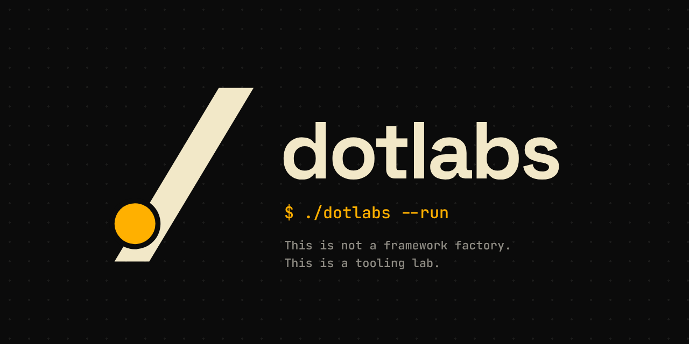

# dotlabs.dev

**dotlabs.dev** is an open-source developer lab focused on building practical tools
that reduce complexity in modern software development.

We design and maintain tools that help developers think clearly about:
- specifications
- infrastructure
- workflows
- and long-term system behavior

This is not a framework factory.
This is a tooling lab.

---

## What We Build

We build **small, focused, composable tools** that solve real problems developers face
when building and operating software.

Our ecosystem includes tools for:

- **Spec-driven development**
- **Event-based workflows**
- **Static and repo-driven site generation**
- **Schema and database lifecycle management**
- **Context, i18n, and data utilities**
- **Python-first UI and component systems**

Most tools are Python-first, but the ideas are language-agnostic.

---

## Philosophy

We believe:

- Specs should come before code
- Infrastructure is part of the product
- Explicit systems scale better than implicit ones
- Automation should be the default, not an afterthought
- Tools should adapt to developers — not the other way around

---

## Example Projects

Some of the tools you’ll find here:

- **spec-ops**  
  Toolkit for Spec-Driven Infrastructure as Code.

- **eventplane**  
  Event-based orchestration and workflow primitives

- **fastpage / page-kit**  
  Serve and build static sites directly from repositories

- **schemactl**  
  Schema and database migration control across engines

- **lucide-py / basecoat-py**  
  UI and icon utilities for Python applications

- **ctx-i18n / jq-utils**  
  Context-aware data access and internationalization helpers

---

## Who This Is For

- Backend & platform engineers
- Infrastructure & DevOps teams
- Product engineers building internal tools
- Teams designing long-lived systems and platforms

If you care about clarity, control, and maintainability — you’ll feel at home here.

---

## Open Source

All projects under **dotlabs.dev** are open-source and community-driven.

Explore, fork, break things, and contribute.

👉 https://github.com/dotlabshq

---

**Build tools. Reduce friction.**

---

## Meet Kudo

🟠 Say hi to **Kudo**, our resident cwd: the little amber dot that lives at the bottom of our slash. Wherever you run `./`, Kudo is already there. [Watch the intro ▶️](https://youtu.be/VslMh2gbBIc)

🌐 [dotlabs.dev](https://dotlabs.dev) · ▶️ [YouTube](https://www.youtube.com/@dotlabshq)
